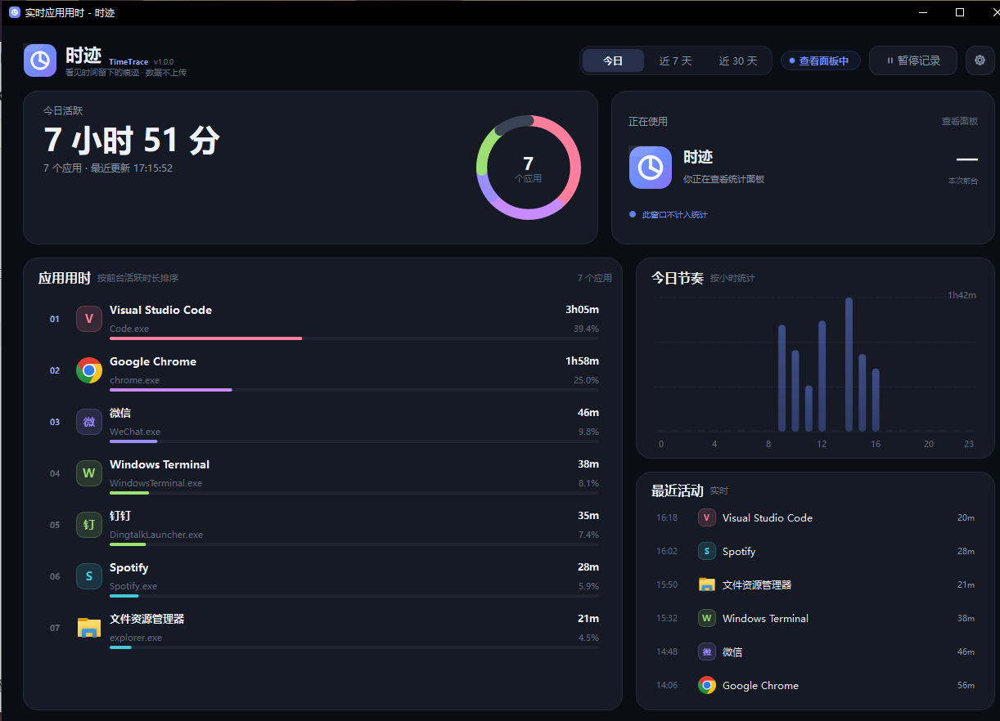
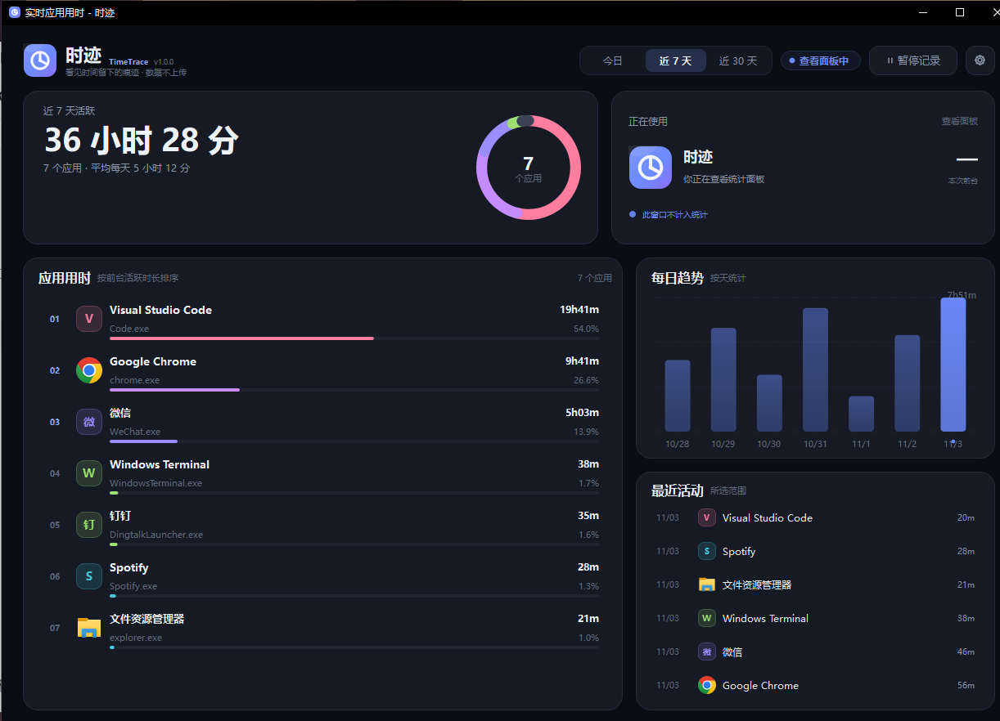

# 时迹 TimeTrace

**看见时间留下的痕迹。**

实时记录 Windows 前台窗口属于哪个软件，按应用、小时、天聚合用时。数据只在本机，不联网、不上传、不需要账号。




## 它回答一个问题

今天的时间花在哪儿了？

- **实时**：每秒采样一次前台窗口，当前应用计时器就在界面上跳。
- **本地**：SQLite 存在自己电脑里，没有账号、没有云端、没有网络请求代码。
- **安静**：常驻托盘，关掉窗口只是收起，不打扰你干活。

## 快速开始

解压 → 双击 `TimeTrace.exe` → 关掉窗口收进托盘，统计就开始了。

完整步骤、托盘操作、数据位置和排错见 [QUICKSTART.md](QUICKSTART.md)。

## 功能

- **实时统计**：每秒采样前台窗口，当前应用计时器实时跳动。
- **按应用排行**：自动识别进程、读取应用图标，展示今日/近 7 天/近 30 天用时和占比。
- **小时与每日趋势**：今日按 24 小时分布，近 7/30 天按天汇总。
- **最近活动**：保留最近的应用切换记录，包含窗口标题。
- **空闲检测**：默认 3 分钟无键盘/鼠标输入就暂停计时；锁屏、登录界面不计入。
- **托盘常驻**：关闭窗口只是隐藏到托盘，继续后台统计；双击托盘图标恢复面板。
- **暂停/恢复**：临时不计时，状态在面板和托盘中同步。
- **开机自启**：可选写入当前用户启动项，启动后最小化到托盘。
- **本地持久化**：SQLite + WAL，每 5 秒落盘；异常退出最多丢几秒。
- **导出 CSV**：从设置里导出全部历史，Excel 可直接打开。
- **单实例**：重复启动只会唤出已经运行的面板。
- **隐私**：不联网、不上传、不需要账号。

## 界面

- **今日活跃**：当天所有应用的累计前台时间。
- **正在使用**：当前前台应用、窗口标题、本次连续用时；空闲/暂停/查看面板时会显示对应状态。
- **应用用时**：按累计时长排序，条形长度表示占比。
- **今日节奏**：24 小时活跃分布，当前小时会高亮。
- **最近活动**：最近的应用切换记录；切到近 7/30 天时显示所选范围内最近记录。
- 顶部支持 `今日 / 近 7 天 / 近 30 天` 切换。

近 7 天视图：



## 统计口径

- 只统计**前台窗口**，后台运行但未激活的软件不计时。
- 以进程名为应用分组，例如 Chrome 的多个标签页、多个窗口合并为 "Google Chrome"。
- 默认空闲阈值为 3 分钟；超过阈值后暂停计时，重新输入后自动开始新的一段。
- 时迹自己的面板窗口、锁屏（`LockApp`）、登录界面不计入。
- 系统睡眠/休眠造成的时间跳变会被识别并跳过，不会把整晚算成某个应用。
- 当前段每 5 秒写入一次 SQLite；切换应用、暂停、退出时会立即收尾。
- 历史数据默认保留 365 天，启动时自动清理更早记录。

## 设置

- **空闲判定**：1 / 3 / 5 / 10 / 15 分钟。
- **开机自动启动**：写入 `HKCU\Software\Microsoft\Windows\CurrentVersion\Run`。
- **启动时最小化到托盘**。
- **打开数据文件夹 / 导出 CSV / 清除全部记录**。

快捷键：`Ctrl + ,` 打开设置。

## 名字

- **时迹**：时间走过之后留下的痕迹。
- **TimeTrace**：Time + Trace，记录时间去了哪里。
- 不叫"计时器"，因为它做的不是提醒你时间在流逝，而是把已经流逝的时间摊开给你看。
- 早期代号是 **TimeFlow**。产品名、仓库名和本地目录都已统一为 TimeTrace，只有 Python 包名保留了旧代号 `timeflow`（`src/timeflow/`）。

## 从源码运行

要求：Windows 10/11，Python 3.10+。

```powershell
git clone https://github.com/zhang-anthonyz/timetrace.git
cd timetrace
python -m venv .venv
.\.venv\Scripts\python.exe -m pip install -r requirements.txt
$env:PYTHONPATH = "src"
.\.venv\Scripts\python.exe main.py --debug
```

或使用封装脚本：

```powershell
powershell.exe -NoProfile -ExecutionPolicy Bypass -File .\run.ps1
```

`run.ps1` 用 `pythonw.exe` 启动，不弹控制台。`--debug` 只影响日志级别，不改变统计行为。

## 测试

```powershell
.\.venv\Scripts\python.exe -m pip install -r requirements-dev.txt
$env:PYTHONPATH = "src"
.\.venv\Scripts\python.exe -m pytest -q
```

覆盖：时长格式化、SQLite 聚合/导出/清理、应用切换、空闲、自排除、暂停、跨小时拆分、设置读写。

## 打包

```powershell
powershell.exe -NoProfile -ExecutionPolicy Bypass -File .\build.ps1
```

脚本会建/复用 `.venv`、装依赖、生成图标、用 PyInstaller `--onedir --windowed` 打包、复制 README/QUICKSTART/LICENSE/docs 并压 zip。产物：

```text
dist\TimeTrace\TimeTrace.exe
dist\TimeTrace-<版本>-Windows-x64.zip
```

解压后整个 `TimeTrace` 文件夹就是绿色版，约 120 MB；zip 约 50 MB。发布时把 zip 挂到 GitHub Releases，仓库里不放二进制。

> 如果 PowerShell 提示"禁止运行脚本"，用上面的 `-ExecutionPolicy Bypass -File` 方式即可，不需要改系统全局策略。

## 项目结构

```text
timetrace/
├─ main.py                     # 开发启动入口
├─ build.ps1 / run.ps1         # 一键打包 / 开发运行
├─ src/timeflow/               # 包名沿用早期代号
│  ├─ app.py                   # 应用生命周期、单实例、托盘接线
│  ├─ tracker.py               # 后台采样线程
│  ├─ engine.py                # 纯计数引擎（可单测）
│  ├─ db.py                    # SQLite 持久化与聚合查询
│  ├─ win32.py                 # 前台窗口 / 空闲 / Win32 调用
│  ├─ display.py               # 进程名 → 友好应用名
│  ├─ autostart.py             # 开机启动
│  ├─ paths.py / config.py     # 数据目录与设置
│  └─ ui/                      # 仪表盘、图表、设置、托盘
├─ tests/                      # pytest
├─ assets/                     # 图标、版本信息
└─ docs/                       # README 截图
```

架构：UI 线程只读快照和 SQLite；采样线程自己持有写连接，每 5 秒提交一次。快照是不可变 dataclass，通过 Qt 信号跨线程投递，界面不直接访问采样状态。

## 常见问题

**打开时提示"未知发布者"，被 SmartScreen 拦住？**
可执行文件没做商业代码签名。点"更多信息 → 仍要运行"。

**关掉主窗口，统计是不是就停了？**
不会。窗口只是隐藏，采样线程继续跑。真正退出走托盘右键 → 退出。

**托盘图标找不到？**
点任务栏的 `^` 展开隐藏图标，把时迹拖到常显区。

**数据在哪？能备份吗？**

```text
%LOCALAPPDATA%\TimeTrace\
├─ timetrace.db         # 用时记录（SQLite）
├─ settings.json        # 设置
├─ ui.ini               # 窗口位置
└─ logs\timetrace.log   # 运行日志
```

复制整个目录即可搬迁或备份；换机器时把它拷到同样位置就能接着看历史。设置里也能直接打开目录、导出 CSV、清除全部记录。

**以前用过旧名字 TimeFlow，旧数据会丢吗？**
不会。首次启动会把旧的数据库、设置和窗口位置复制到 `TimeTrace` 目录，旧目录原地保留。

**会不会上传我的使用记录？**
不会。代码里没有任何网络请求，窗口标题和用时只写本机 SQLite。

**后台放音乐 / 下载 / 编译为什么不计时？**
只统计获得焦点的前台窗口，这是设计取舍：它回答"我在用哪个软件"，不是"哪个进程在跑"。

**断电或强制结束进程会丢多少数据？**
当前段每 5 秒落盘一次，最多丢几秒。

## 已知限制

- 仅支持 Windows 10 / 11 x64。
- 同一时刻只统计一个前台窗口；分屏同时看两个应用时，只有获得焦点的那个计时。
- UWP / Microsoft Store 应用通过 `ApplicationFrameHost` 子窗口做尽力识别，极少数应用可能显示为宿主进程。
- 应用按进程名分组，不区分同一进程的不同账号/项目。
- 空闲时间是"超过阈值后停止计时"，阈值内的无输入仍会算在前台应用上。
- 没有云同步、自动更新、代码签名，这些不在本版本范围内。

## 隐私

时迹不包含任何网络请求代码。窗口标题、进程路径、用时记录都只写入本机 `%LOCALAPPDATA%\TimeTrace`，删除该目录即可彻底清除本地数据。

## 贡献

Issue 和 PR 都欢迎。改代码前先跑一遍 `pytest -q`；新增统计行为请补对应测试。提交信息用 `type: 中文简述`（如 `fix: 跨小时拆分少算一秒`）。

## License

MIT


